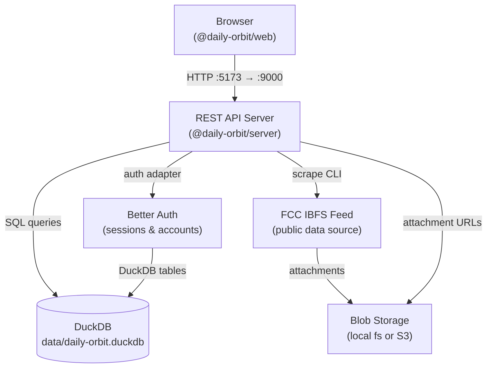

# The Daily Orbit

An FCC IBFS Explorer

## 1. Project Overview

This codebase provides a web-based interface for exploring the publicly filed Applications to the US Federal Communications Commission's International Bureau Filing System (IBFS). The IBFS is a database, application filing system, and processing system, hosted by the US federal government, for all International and Satellite services.

The main purpose of this software is to provide its users deep insights into the competitive landscape of the satellite communications industry, and the legal issues that inform it. To that end, the tool offers a personalized, web-based interface for exploring the data provided by IBFS: the content of the FCC-submitted Applications, the entities who filed or commented on them, and the documents associated with them. Specific web pages for individial Applications, Applicants, and other entities are provided to help the user understand the overall picture and provide actionable data.

## 2. Application Types

The following applications are available on IBFS for electronic filing:

- Space and Earth Station Applications:
  - Earth Station Authorizations – Form 312
  - Earth Station Special Temporary Authority
  - Space Station Authorizations – Form 312
  - Space Station Special Temporary Authority
  - Modifications of Authorization – Form 312
  - Amendments to Pending Applications – Form 312
  - Transfers of Control of License – Form 312
  - Assignments of License – Form 312
- International Accounting Rate Change Filings
- Submarine Cable Landing License Applications
- Requests for Assignment of Data Network Identification Codes
- Foreign Carrier Affiliation Notification Filings
- International Section 214 Applications
- International Section 214 Special Temporary Authority
- International Signaling Point Code Filings
- Recognized Operating Agency Filings
- Renewal of Radio License in Specific Services

## 3. Comments

IBFS Applications are subject to public comment before approval and an individual comment may be filed against more than one Application, resulting in a many-to-many relationship. The most frequent commenters are the handful of major satellite communications players who file the Applications themselves, because the comments provide a competitive forum for adversarial blocking or delaying of a competitor's Application. Since the number of posible physical satellite orbits is limited, as is the number of non-overlapping frequency bands licensed for talking to them, _both_ of these resources are effectively scarce, and the firms compete aggressively for frequency and orbital licenses.

## 4. Attachments

Many applications require extra information in the form of attachments. The IBFS site states that they accept attachments in the following formats: Word, Adobe Acrobat, Excel and Text. However, in practice, other formats are frequently submitted, and will be encountered as attachments. Comments to Applications may also contain attachments.

This application downloads and stores all Application and Comment attachments into its blob storage.
When possible, the attachment's text content is extracted and indexed for search.

## 5. Configuration

All application configuration is stored in the DuckDB database and managed via the CLI. See [doc/configuration.md](doc/configuration.md) for details on config keys, encryption, the `SecretValue` wrapper, and the `daily-orbit config` CLI commands.

## 6. CLI

The `daily-orbit` CLI provides commands for server operation, data ingestion, attachment management, configuration, and ad-hoc database queries. Run it directly via Node or through Make targets:

```bash
# Direct invocation
node --no-warnings packages/server/src/bin.ts --help

# Or via Makefile (most common tasks have targets)
make help
```

Top-level commands:

```
daily-orbit serve          Start the HTTP server
daily-orbit config         Manage application configuration
daily-orbit ingest         Data ingestion (ibfs, icfs)
daily-orbit attachments    Attachment discovery and download
daily-orbit db             Database utilities
```

Every command and subcommand supports `--help` for usage details:

```bash
node --no-warnings packages/server/src/bin.ts ingest icfs --help
```

For the full CLI reference, see [doc/CLI.md](doc/CLI.md).

## 7. Architecture

The project is a pnpm monorepo with two packages:



### Packages

| Package               | Path               | Port | Purpose                               |
| --------------------- | ------------------ | ---- | ------------------------------------- |
| `@daily-orbit/web`    | `packages/web/`    | 5173 | Vite + React + fbtee frontend         |
| `@daily-orbit/server` | `packages/server/` | 9000 | Hono REST API + auth + data ingestion |

### Data flow

1. The **scrape CLI** fetches Application metadata and attachments from the FCC IBFS feed and stores them in DuckDB + blob storage.
2. The **server** exposes a REST API consumed by the browser frontend and enforces session-based auth via Better Auth.
3. The **web** client renders Application, Applicant, and Comment views driven entirely by the API.

## 8. Technologies

### Frontend (`packages/web`)

- [Vite](https://vitejs.dev/) + [React 19](https://reactjs.org/) with [React Compiler](https://react.dev/learn/react-compiler)
- [Tailwind CSS](https://tailwindcss.com/)
- [fbtee](https://github.com/nkzw-tech/fbtee) for i18n
- [Better Auth](https://www.better-auth.com/) for authentication
- [React Router v7](https://reactrouter.com/)

### Backend (`packages/server`)

- [Hono](https://hono.dev/) on [Node.js 23+](https://nodejs.org/) (native TypeScript strip-types)
- [DuckDB](https://duckdb.org/) via `@duckdb/node-api`
- [Better Auth](https://www.better-auth.com/) with a custom DuckDB adapter
- [tsdown](https://github.com/sxzz/tsdown) (Rolldown-based) for production builds

### Shared tooling

- [TypeScript](https://www.typescriptlang.org) + [tsgo](https://github.com/microsoft/typescript-go) for type checking
- [oxlint](https://oxc.rs/docs/guide/usage/linter.html) + [oxfmt](https://github.com/nicolo-ribaudo/oxfmt) for linting and formatting
- [vitest](https://vitest.dev/) for testing
- [pnpm](https://pnpm.io/) workspaces
