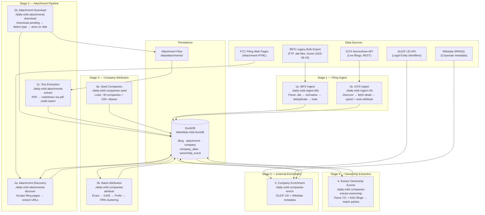

# Data Ingestion & Enhancement Pipeline

> **Maintainer note:** Update this document whenever pipeline steps are added, removed, or reordered.

## Overview

Daily Orbit maintains a multi-stage pipeline that transforms raw FCC filing data into an enriched, company-attributed, searchable dataset. The pipeline draws from two primary government data sources (IBFS legacy and ICFS live), discovers and downloads binary attachments, extracts full text from PDF attachments, attributes filings to canonical company entities, extracts ownership-change events, and enriches company records from external registries.

All pipeline stages are **idempotent** and designed to run nightly.

---

## Pipeline Diagram



---

## Stage 1 — Filing Ingest

### 1a. IBFS Legacy Bulk Ingest

| | |
|---|---|
| **Command** | `make ingest` or `make ingest-download` |
| **CLI** | `./daily-orbit ingest ibfs [--download] [--dry-run]` |
| **Source** | `ftp://ftp.fcc.gov/pub/Bureaus/International/databases/IBFS.zip` |
| **Status** | **Frozen** — FCC replaced IBFS with ICFS on 2025-06-24 |
| **Writes to** | `filing` table + related lookup tables |

**Flow:**

1. (Optional) Download and extract `IBFS.zip` → `tmp/IBFS/`
2. Parse Sybase DDL schema from `tmp/ibfs-schema.txt`
3. For each table with a `.dat` file:
   - Parse binary records using `dat-parser.ts`
   - Normalize file numbers to canonical format (`SUB-TYPE-YYYYMMDD-NNNNN`)
   - Deduplicate rows by primary key (keep latest)
4. First load: CREATE TABLE + fast Appender bulk insert
   Subsequent loads: staging table + MERGE upsert
5. Record unknown columns in `unknown_columns` table
6. Log run in `ingest_log` table

**Key options:** `--tables` (filter), `--dry-run` (parse-only), `--download` (fetch from FTP first)

---

### 1b. ICFS New Filing Ingest

| | |
|---|---|
| **Command** | `make icfs-ingest DATE_FROM=YYYY-MM` |
| **CLI** | `./daily-orbit ingest icfs --date-from YYYY-MM [--date-to YYYY-MM]` |
| **Source** | FCC ICFS ServiceNow REST API |
| **Default scope** | Subsystems: SAT, SES; App types: LOA, MOD, STA, AMD, T/C, ASG, LIC, RWL, REG |
| **Writes to** | `filing` table (upsert), sets `company_id` via auto-attribution |

**Two discovery modes:**

- **Date-range** (default): Generate queries `{SUBSYS}-{APPTYPE}-{YYYYMM}` for each month in range, search ServiceNow, collect file numbers, then fetch details
- **Direct file numbers**: `--file-numbers SAT-LOA-20250221-00050,...` skips discovery

**Per-filing flow:**

1. Fetch `IcfsFilingDetail` from ServiceNow (summary, transfer parties, service types, attachments, pleadings)
2. Upsert into `filing`:
   - Existing row → update ICFS-sourced columns only (preserves IBFS data)
   - New row → insert with legacy key or synthetic hash
3. Auto-attribute to company via `attributeFiling()` (same 3-tier logic as batch)

**Key options:** `--subsystems`, `--app-types`, `--delay` (default 500ms), `--concurrency` (default 4)

---

## Stage 2 — Attachment Pipeline

### 2a. Attachment Discovery

| | |
|---|---|
| **Command** | `make attachments-discover` |
| **CLI** | `./daily-orbit attachments discover [OPTIONS]` |
| **Source** | FCC legacy report HTML pages |
| **Writes to** | `attachment` table (metadata rows with `download_status = 'pending'`) |

**Flow:**

1. Query `filing` table for filings matching scope filters
2. For each un-scraped (or stale) filing:
   - Scrape FCC filing page HTML
   - Extract attachment metadata from Attachments table and Files table
3. Upsert attachment rows (deduplicated by `attachment_key`)
4. Mark filing as discovered with timestamp

**Key options:** `--filing`, `--subsystem`, `--date-from`, `--date-to`, `--limit`, `--stale-after`

### 2b. Attachment Download

| | |
|---|---|
| **Command** | `make attachments-download` |
| **CLI** | `./daily-orbit attachments download [OPTIONS]` |
| **Source** | FCC download URLs stored in `attachment` table |
| **Writes to** | `data/attachments/{subsystem}/{file_number}/` + updates `attachment` table |

**Flow:**

1. Query pending attachments (`download_status = 'pending'` or `'failed'` with `--retry-failed`)
2. Pre-flight: check if file already on disk → reconcile DB without re-downloading
3. Download to temp path → detect content type → rename with correct extension
4. Update DB: `local_path`, `file_size_bytes`, `content_type`, `downloaded_at`, `download_status`

**Combined command:** `make attachments` runs discover + download in one pass.

### 2c. Text Extraction

| | |
|---|---|
| **Command** | `make attachments-extract` |
| **CLI** | `./daily-orbit attachments extract [OPTIONS]` |
| **Source** | Downloaded PDF files in `data/attachments/` |
| **Writes to** | `attachment` table: `full_text`, `text_length`, `extract_status` |

**Flow:**

1. Query attachments where `download_status = 'downloaded'`, `content_type = 'application/pdf'`, and `extract_status = 'pending'`
2. For each PDF, read bytes from disk and extract per-page markdown via `pdf-oxide-wasm`
3. Classify result:
   - **extracted** — ≥ 50 non-whitespace chars → store `full_text` + `text_length`
   - **skipped_no_text** — < 50 chars (scanned/image-only PDF) → mark skipped
   - **failed** — parse error or file not found → mark failed
4. Progress bar shown on stderr

**Key options:** `--limit`, `--retry-failed`, `--verbose`

---

## Stage 3 — Company Attribution

### 3a. Seed Companies

| | |
|---|---|
| **Command** | `make companies-seed` |
| **CLI** | `./daily-orbit companies seed` |
| **Source** | Built-in `seed-data.ts` (~80 companies, 300+ aliases including prefix patterns) |
| **Writes to** | `company` + `company_alias` tables |

Idempotent: skips companies whose canonical name already exists as an alias. Adds any missing aliases on re-run. Sets parent-subsidiary relationships in a second pass.

### 3b. Batch Attribution

| | |
|---|---|
| **Command** | `make companies-attribute` |
| **CLI** | `./daily-orbit companies attribute` |
| **Source** | `filing` table (rows where `company_id IS NULL`) |
| **Writes to** | `filing.company_id` |

Four-tier deterministic matching for each unattributed filing:

1. **Exact alias match** — `filing.address_attention` = `company_alias.alias_name`
2. **Case-insensitive match** — ILIKE comparison
3. **Prefix alias match** — `filing.address_attention` starts with a registered prefix alias (e.g., `"Comcast of "` matches `"Comcast of Florida/Michigan/..."`)
4. **FRN clustering** — find any already-attributed filing with the same `applicant_frn`, inherit its `company_id`

No match → filing stays unattributed (company_id remains NULL).

**Note:** ICFS filings are also auto-attributed at ingest time (Stage 1b), so the batch mainly catches legacy IBFS filings and any edge cases.

### Attribution Stats

| | |
|---|---|
| **Command** | `make companies-stats` |
| **CLI** | `./daily-orbit companies stats` |

Read-only report: total/attributed/unattributed counts, coverage %, and top 25 unattributed applicant names.

---

## Stage 4 — Ownership Extraction

| | |
|---|---|
| **Command** | `make companies-extract-ownership` |
| **CLI** | `./daily-orbit companies extract-ownership` |
| **Source** | `filing` table (rows where `app_type_code IN ('T/C', 'ASG')`) |
| **Writes to** | `ownership_event` table |

**Flow:**

1. Query T/C (Transfer of Control) and ASG (Assignment) filings that have transfer party data and no existing ownership event
2. For each filing, match `transferor_name` and `transferee_name` to companies via alias lookup
3. If at least one party is identified → create `ownership_event` with type, status (derived from `status_code`), and effective date
4. Skip if neither party can be matched

**Status mapping:** G → granted, D → denied, P/A → pending, X → dismissed

---

## Stage 5 — External Enrichment

| | |
|---|---|
| **Command** | `make companies-enrich` |
| **CLI** | `./daily-orbit companies enrich` |
| **Sources** | GLEIF LEI API + Wikidata SPARQL endpoint |
| **Writes to** | `company` table fields: `gleif_lei`, `wikidata_id`, `stock_ticker`, `stock_exchange`, `industry` |

**Per-company flow:**

1. **GLEIF** — search by legal name → extract LEI (Legal Entity Identifier)
   - Rate limit: 300ms between requests
2. **Wikidata** — SPARQL query for P749 (parent org), P414 (stock exchange), P249 (ticker), P452 (industry)
   - Rate limit: 1 req/sec, custom User-Agent header
3. Update company record with any newly found fields
4. External API failures are non-fatal (logged and skipped)

Only queries companies missing `gleif_lei` or `wikidata_id` — already-enriched companies are skipped.

---

## Nightly Run Sequence

The recommended nightly pipeline order:

```bash
# 1. Ingest new filings from ICFS (includes auto-attribution)
make icfs-ingest DATE_FROM=$(date -v-1m +%Y-%m)

# 2. Discover and download attachments for new filings
make attachments

# 2c. Extract text from newly downloaded PDFs
make attachments-extract

# 3. Ensure company seed data is current (no-ops if unchanged)
make companies-seed

# 4. Attribute any remaining unattributed filings
make companies-attribute

# 5. Extract ownership events from new T/C and ASG filings
make companies-extract-ownership

# 6. Enrich any companies missing external data
make companies-enrich

# 7. (Optional) Report attribution coverage
make companies-stats
```

---

## Rate Limiting & Concurrency

| Pipeline | Default Delay | Default Concurrency | Notes |
|---|---|---|---|
| ICFS Discovery | 500ms | 4 | Per discovery query batch |
| ICFS Fetch | 500ms | 4 | Per filing detail fetch |
| Attachment Discovery | 500ms | 1 | Per filing page scrape |
| Attachment Download | 500ms | 1 | Per file download |
| GLEIF API | 300ms | 1 | Built-in rate limiter |
| Wikidata SPARQL | 1000ms | 1 | Per Wikidata policy |

All pipeline stages accept `--delay` and `--concurrency` overrides (except enrichment, which uses built-in rate limiters).

---

## Error Handling & Recovery

| Stage | Behavior | Recovery |
|---|---|---|
| IBFS Ingest | Logs failure to `ingest_log` table | Re-run; `--dry-run` to validate |
| ICFS Ingest | Per-filing error tracking, continues others | Re-run with `--file-numbers` for specific failures |
| Attachment Discovery | Per-filing errors isolated, continues | Re-run; `--stale-after` re-discovers stale entries |
| Attachment Download | Marks individual attachments as `'failed'` | `--retry-failed` retries; `--skip-existing` reconciles disk |
| Text Extraction | Marks individual attachments as `'failed'` or `'skipped_no_text'` | `--retry-failed` retries failed; skipped PDFs stay skipped |
| Company Attribution | Pure DB operation, no external calls | Re-run; always processes only `company_id IS NULL` rows |
| Ownership Extraction | Skips unmatched parties, continues | Add missing company aliases, then re-run |
| External Enrichment | API failures are non-fatal, per-company | Re-run; only retries companies missing data |

---

## Key File Locations

| Purpose | Path |
|---|---|
| DuckDB database | `data/daily-orbit.duckdb` |
| Attachment files | `data/attachments/{subsystem}/{file_number}/` |
| IBFS bulk data | `tmp/IBFS/` (extracted `.dat` files) |
| IBFS schema DDL | `tmp/ibfs-schema.txt` |
| CLI entry point | `packages/server/src/bin.ts` |
| CLI commands | `packages/server/src/cli/` |
| IBFS pipeline | `packages/server/src/ingest/` |
| ICFS pipeline | `packages/server/src/icfs/` |
| Attachments pipeline | `packages/server/src/attachments/` |
| Companies module | `packages/server/src/companies/` |
| Enrichment module | `packages/server/src/enrichment/` |
| Makefile | `Makefile` |
