# Data Ingestion & Enhancement Pipeline

> **Maintainer note:** Update this document whenever pipeline steps are added, removed, or reordered.

## Overview

Daily Orbit maintains a multi-stage pipeline that transforms raw FCC filing data and industry news into an enriched, company-attributed, searchable dataset. The pipeline draws from two primary government data sources (IBFS legacy and ICFS live), discovers and downloads binary attachments, validates their actual content types via file-magic detection, extracts full text from PDF, HTML, text, and CSV attachments, generates LLM-powered summaries via AWS Bedrock, attributes filings to canonical company entities, extracts ownership-change events, enriches company records from external registries, and ingests industry news articles from RSS/Atom feeds.

All pipeline stages are **idempotent** and designed to run nightly.

---

## Pipeline Diagram

```mermaid
%%{init: {'flowchart': {'nodeSpacing': 40, 'rankSpacing': 80, 'subGraphTitleMargin': {'top': 10, 'bottom': 10}}}}%%
flowchart TD
    subgraph sources["Data Sources"]
        IBFS["IBFS Legacy Bulk Export\n(FTP .dat files, frozen 2025-06-24)"]
        ICFS["ICFS ServiceNow API\n(Live filings, REST)"]
        FCC_PAGES["FCC Filing Web Pages\n(Attachment HTML)"]
        BEDROCK["AWS Bedrock\n(LLM inference)"]
        GLEIF["GLEIF LEI API\n(Legal Entity Identifiers)"]
        WIKIDATA["Wikidata SPARQL\n(Corporate metadata)"]
        RSS_FEEDS["RSS/Atom Feeds\n(Industry news sources)"]
    end

    subgraph ingest["Stage 1 — Filing Ingest"]
        IBFS_INGEST["1a. IBFS Ingest\n./daily-orbit ingest ibfs\nParse .dat → normalize → deduplicate → load"]
        ICFS_INGEST["1b. ICFS Ingest\n./daily-orbit ingest icfs\nDiscover → fetch detail → upsert + auto-attribute"]
    end

    subgraph attachments["Stage 2 — Attachment Pipeline"]
        ATT_DISCOVER["2a. Attachment Discovery\n./daily-orbit attachments discover\nScrape filing pages → extract URLs"]
        ATT_DOWNLOAD["2b. Attachment Download (public)\n./daily-orbit attachments download\nDownload pending → detect type → store on disk"]
        ATT_AUTH["2b′. Authenticated Download\n./daily-orbit attachments download --auth-cookies\nServiceNow URLs via session cookies"]
        ATT_VALIDATE["2c. Content-Type Validation\n./daily-orbit attachments validate\nfile magic → correct MIME type"]
        ATT_EXTRACT["2d. Text Extraction\n./daily-orbit attachments extract\nPDF/HTML/text/CSV → full text"]
        ATT_SUMMARIZE["2e. Summarization\n./daily-orbit inference summarize\nExtracted text → LLM summary via Bedrock"]
        ATT_EMBED["2f. Vector Embedding\n./daily-orbit inference embed\nChunked full-text → Titan V2 embeddings via Bedrock"]
        FTS_REBUILD["2g. FTS Index Rebuild\n./daily-orbit search rebuild-index\nBM25 indexes on filing + attachment + pleading"]
    end

    subgraph company["Stage 3 — Company Attribution"]
        SEED["3a. Seed Companies\n./daily-orbit companies seed\nLoad ~30 companies + 100+ aliases"]
        ATTRIBUTE["3b. Batch Attribution\n./daily-orbit companies attribute\nExact → ILIKE → Prefix → FRN clustering"]
    end

    subgraph ownership["Stage 4 — Ownership Extraction"]
        EXTRACT["4. Extract Ownership Events\n./daily-orbit companies extract-ownership\nParse T/C + ASG filings → match parties"]
    end

    subgraph enrichment["Stage 5 — External Enrichment"]
        ENRICH["5. Company Enrichment\n./daily-orbit companies enrich\nGLEIF LEI + Wikidata metadata"]
    end

    subgraph news["Stage 6 — News Pipeline"]
        NEWS_SEED["6a. Seed News Sources\n./daily-orbit news seed\nLoad built-in RSS feed list"]
        NEWS_FETCH["6b. Fetch RSS Feeds\n./daily-orbit news fetch\nParse feeds → upsert news items"]
        NEWS_EXTRACT["6c. Extract Article Text\n./daily-orbit news extract\nFetch URL → HTML to markdown"]
        NEWS_SUMMARIZE["6d. Summarize Articles\n./daily-orbit news summarize\nLLM summary via Bedrock"]
        NEWS_ATTRIBUTE["6e. Attribute to Companies\n./daily-orbit news attribute\nAlias matching on title + text"]
    end

    subgraph storage["Persistence"]
        DB[("DuckDB\ndata/daily-orbit.duckdb\n\nfiling · attachment · company\ncompany_alias · ownership_event\nnews_source · news_item")]
        DISK["Attachment Files\ndata/attachments/"]
    end

    IBFS --> IBFS_INGEST
    ICFS --> ICFS_INGEST
    IBFS_INGEST --> DB
    ICFS_INGEST --> DB

    FCC_PAGES --> ATT_DISCOVER
    DB --> ATT_DISCOVER
    ATT_DISCOVER --> DB
    ATT_DOWNLOAD --> DB
    ATT_DOWNLOAD --> DISK
    ATT_AUTH --> DB
    ATT_AUTH --> DISK
    DISK --> ATT_VALIDATE
    ATT_VALIDATE --> DB
    DISK --> ATT_EXTRACT
    ATT_EXTRACT --> DB
    DB --> ATT_SUMMARIZE
    BEDROCK --> ATT_SUMMARIZE
    ATT_SUMMARIZE --> DB
    DB --> ATT_EMBED
    BEDROCK --> ATT_EMBED
    ATT_EMBED --> DB
    DB --> FTS_REBUILD
    FTS_REBUILD --> DB

    SEED --> DB
    DB --> ATTRIBUTE
    ATTRIBUTE --> DB

    DB --> EXTRACT
    EXTRACT --> DB

    GLEIF --> ENRICH
    WIKIDATA --> ENRICH
    DB --> ENRICH
    ENRICH --> DB

    NEWS_SEED --> DB
    RSS_FEEDS --> NEWS_FETCH
    DB --> NEWS_FETCH
    NEWS_FETCH --> DB
    DB --> NEWS_EXTRACT
    NEWS_EXTRACT --> DB
    DB --> NEWS_SUMMARIZE
    BEDROCK --> NEWS_SUMMARIZE
    NEWS_SUMMARIZE --> DB
    DB --> NEWS_ATTRIBUTE
    NEWS_ATTRIBUTE --> DB
```



---

## Stage 1 — Filing Ingest

### 1a. IBFS Legacy Bulk Ingest

| | |
|---|---|
| **Command** | `./daily-orbit ingest ibfs [--download] [--dry-run]` |
| **Source** | `ftp://ftp.fcc.gov/pub/Bureaus/International/databases/IBFS.zip` |
| **Status** | **Frozen** — FCC replaced IBFS with ICFS on 2025-06-24 |
| **Writes to** | `filing` table + related lookup tables |

**Flow:**

1. (Optional) Download and extract `IBFS.zip` → `tmp/IBFS/`
2. Parse Sybase DDL schema from `tmp/ibfs-schema.txt`
3. For each table with a `.dat` file:
   - Parse binary records using `dat-parser.ts`
   - Normalize file numbers to canonical format (`SUB-TYPE-YYYYMMDD-NNNNN`)
   - Deduplicate rows by primary key (keep latest)
4. First load: CREATE TABLE + fast Appender bulk insert
   Subsequent loads: staging table + MERGE upsert
5. Record unknown columns in `unknown_columns` table
6. Log run in `ingest_log` table

**Key options:** `--tables` (filter), `--dry-run` (parse-only), `--download` (fetch from FTP first)

---

### 1b. ICFS New Filing Ingest

| | |
|---|---|
| **Command** | `./daily-orbit ingest icfs --date-from YYYY-MM [--date-to YYYY-MM]` |
| **Source** | FCC ICFS ServiceNow REST API |
| **Default scope** | Subsystems: SAT, SES; App types: LOA, MOD, STA, AMD, T/C, ASG, LIC, RWL, REG |
| **Writes to** | `filing` table (upsert), sets `company_id` via auto-attribution |

**Two discovery modes:**

- **Date-range** (default): Generate queries `{SUBSYS}-{APPTYPE}-{YYYYMM}` for each month in range, search ServiceNow, collect file numbers, then fetch details
- **Direct file numbers**: `--file-numbers SAT-LOA-20250221-00050,...` skips discovery

**Per-filing flow:**

1. Fetch `IcfsFilingDetail` from ServiceNow (summary, transfer parties, service types, attachments, pleadings)
2. Upsert into `filing`:
   - Existing row → update ICFS-sourced columns only (preserves IBFS data)
   - New row → insert with legacy key or synthetic hash
3. Auto-attribute to company via `attributeFiling()` (same 3-tier logic as batch)

**Key options:** `--subsystems`, `--app-types`, `--delay` (default 500ms), `--concurrency` (default 4)

---

## Stage 2 — Attachment Pipeline

### 2a. Attachment Discovery

| | |
|---|---|
| **Command** | `./daily-orbit attachments discover [OPTIONS]` |
| **Source** | FCC legacy report HTML pages |
| **Writes to** | `attachment` table (metadata rows with `download_status = 'pending'`) |

**Flow:**

1. Query `filing` table for filings matching scope filters
2. For each un-scraped (or stale) filing:
   - Scrape FCC filing page HTML
   - Extract attachment metadata from Attachments table and Files table
3. Upsert attachment rows (deduplicated by `attachment_key`)
4. Mark filing as discovered with timestamp

**Key options:** `--filing`, `--subsystem`, `--date-from`, `--date-to`, `--limit`, `--stale-after`

### 2b. Attachment Download (public)

| | |
|---|---|
| **Command** | `./daily-orbit attachments download [OPTIONS]` |
| **Source** | FCC download URLs stored in `attachment` table |
| **Writes to** | `data/attachments/{subsystem}/{file_number}/` + updates `attachment` table |

**Flow:**

1. Query pending attachments (`download_status = 'pending'` or `'failed'` with `--retry-failed`)
2. Filter out undownloadable URLs (empty, `/ibfs?` form links, `/nav_to` navigation links) → mark as `download_status = 'skipped'`
3. Pre-flight: check if file already on disk → reconcile DB without re-downloading
4. Download to temp path → detect content type → rename with correct extension
5. Update DB: `local_path`, `file_size_bytes`, `content_type`, `downloaded_at`, `download_status`

**Combined command:** `./daily-orbit attachments sync` runs discover + download + text extraction in one pass.

### 2b′. Authenticated Attachment Download (ServiceNow)

Attachments hosted at `fccprod.servicenowservices.com` require FCC Okta SSO
authentication. The pipeline supports a semi-automated workflow: a human logs
in once via browser, session cookies are extracted, and the download pipeline
uses those cookies to fetch ServiceNow-hosted attachments.

#### One-time setup

Install the Playwright browser used for cookie extraction:

```bash
pnpx playwright install chromium
```

#### Cookie extraction

| | |
|---|---|
| **Command** | `./daily-orbit attachments extract-cookies [--output PATH]` |
| **Output** | `data/icfs-cookies.json` |

The command opens a Chromium browser to the ICFS login page. The operator
completes SSO login (email + password + 2FA if prompted), then returns to
the terminal and presses **Enter**. The CLI extracts all ServiceNow session
cookies from the browser and writes them to a JSON file.

#### Authenticated download

| | |
|---|---|
| **Command** | `./daily-orbit attachments download --auth-cookies data/icfs-cookies.json --retry-failed` |
| **Source** | `attachment` rows where `download_url LIKE '%servicenowservices.com%'` |
| **Writes to** | `data/attachments/{subsystem}/{file_number}/` + updates `attachment` table |

When `--auth-cookies` is provided, the pipeline:

- Filters to only ServiceNow-hosted attachment URLs
- Sends the session cookie with each download request
- Does **not** follow HTTP redirects (a 302 means the session expired)
- On session expiry, stops gracefully and logs the count of successful
  downloads — remaining attachments stay `pending` for the next run
- Skips the `.pdf` URL suffix normalization used for fcc.report URLs

**Session lifetime:** ServiceNow sessions expire after roughly 30 minutes
(governed by the `glide_session_store` cookie). For daily operations this is
more than enough — a typical day's new filings produce only a handful of
attachments. If a large backlog run outlasts the session, re-extract cookies
and re-run; the pipeline picks up where it left off.

#### Daily procedure

```bash
# 1. Extract cookies (opens browser — log in, then press Enter)
./daily-orbit attachments extract-cookies

# 2. Download authenticated attachments
./daily-orbit attachments download --auth-cookies data/icfs-cookies.json --retry-failed

# 3. Extract text from newly downloaded PDFs
./daily-orbit attachments extract
```

### 2c. Content-Type Validation

| | |
|---|---|
| **Command** | `./daily-orbit attachments validate [OPTIONS]` |
| **Source** | Downloaded files on disk |
| **Writes to** | `attachment` table: `content_type`, `content_type_source` |

**Why:** The FCC serves ~778 non-PDF files with `Content-Type: application/pdf` — mostly plain-text Schedule S cross-references, plus some zip archives and CSV files. Without validation, the extraction pipeline wastes time trying to parse non-PDFs, and legitimate text content never gets ingested.

**Flow:**

1. Query attachments where `download_status = 'downloaded'` and `content_type_source` is `'http_header'` or NULL
2. For each file, run `file --brief --mime-type` to detect actual MIME type
3. Update `content_type` to the detected type and set `content_type_source = 'file_magic'`
4. Corrected content types change which files reach the extraction stage (e.g. zip archives are excluded, text files are read directly)

**Integration:** Validation runs automatically before text extraction in both the main pipeline (`attachments sync`) and the standalone extraction pipeline (`attachments extract`). It can also be run standalone.

**Key options:** `--limit`, `--verbose`

### 2d. Text Extraction

| | |
|---|---|
| **Command** | `./daily-orbit attachments extract [OPTIONS]` |
| **Source** | Downloaded files in `data/attachments/` (PDF, text, CSV, HTML) |
| **Writes to** | `attachment` table: `full_text`, `text_length`, `text_checksum`, `extract_status` |

**Supported content types:**

| Content Type | Method | Notes |
|---|---|---|
| `application/pdf` | `pdf-oxide-wasm` (WASM), fallback to `pdftotext` (poppler) | Per-page markdown with heading detection |
| `text/plain` | Direct UTF-8 read | Minimum 10 non-whitespace chars |
| `text/csv` | Direct UTF-8 read | Same threshold as plain text |
| `text/html` | `node-html-parser` DOM parse → text extraction | Strips script/style/noscript; auth-failure stubs detected and skipped |

**Flow:**

1. Run content-type validation on any unvalidated downloaded files (see 2c)
2. Query attachments where `download_status = 'downloaded'`, `content_type IN ('application/pdf', 'text/plain', 'text/csv', 'text/html')`, and `extract_status = 'pending'`
3. Dispatch by content type:
   - **PDF** — read bytes, extract per-page markdown via `pdf-oxide-wasm`
   - **Text/CSV** — read as UTF-8 text
   - **HTML** — check for auth-failure stub (< 500 bytes + error pattern), then parse DOM and extract text
4. Classify result:
   - **extracted** — ≥ 50 non-whitespace chars (PDF/HTML) or ≥ 10 chars (text/CSV) → store `full_text` + `text_length` + `text_checksum` (MD5 of full text)
   - **skipped_no_text** — below threshold (scanned/image-only PDF, empty HTML) → mark skipped
   - **skipped_auth_error** — HTML auth-failure stub (download error page) → mark skipped for potential re-download
   - **failed** — parse error or file not found → mark failed
5. Progress bar shown on stderr

**Key options:** `--limit`, `--retry-failed`, `--verbose`

### 2e. Summarization

| | |
|---|---|
| **Command** | `./daily-orbit inference summarize [OPTIONS]` |
| **Source** | `attachment` table (rows where `full_text IS NOT NULL AND summary IS NULL`) |
| **Writes to** | `attachment.summary`, `attachment.summarized_by`, `attachment.summarized_at` |

**Flow:**

1. Query attachments with extracted text but no summary, joined with `filing` for metadata (includes `text_checksum`)
2. **Deduplication check:** Before calling the LLM, look up `text_checksum` in the attachment table. If another attachment with the same checksum already has a summary, copy it directly and set `summarized_by = 'copied'`. This saves ~27% of API calls on the current dataset (boilerplate FCC forms filed identically across hundreds of applications).
3. For remaining attachments, render a Mustache prompt template with filing context variables (`fileNumber`, `applicantName`, `dateFiled`, `appTypeCode`, `subsystemCode`, `attachmentName`, `fullText`, `companyName`)
4. Send to AWS Bedrock via the app's `InferenceService` abstraction
5. Write the LLM-generated summary back to `attachment.summary` with `summarized_by = {modelId}`

**Integration:** Summarization also runs as a later stage of `./daily-orbit attachments sync`, after text extraction. The sync pipeline uses the same idempotent query (skips already-summarized rows).

**Prompt configuration:** System and user prompt templates are configurable via the admin UI (AI Settings page) and stored as config keys `summarizationSystemPrompt` and `summarizationUserPrompt`. Blank values fall back to built-in defaults defined in `packages/server/src/inference/prompts.ts`.

**Key options:** `--model` (default: `us.amazon.nova-pro-v1:0`), `--region` (default: `us-east-2`), `--concurrency` (default: 10), `--batch` (default: 100), `--limit`, `--dry-run`

---

### 2f. Vector Embedding

| | |
|---|---|
| **Command** | `./daily-orbit inference embed [OPTIONS]` |
| **Source** | `attachment.full_text`, `filing.description`, `pleading.exhibit_attachment_html`, `news_item.full_text` |
| **Writes to** | `embedding` table (one row per chunk per source document) |

**Flow:**

1. For each source table (attachment, filing, pleading, news_item):
   - Query rows with non-NULL text that have no embedding, or whose text has changed (MD5 checksum mismatch)
2. For each row:
   - Compute `text_checksum` (MD5 of source text)
   - Split text into chunks of ≤ 30,000 chars with 500-char overlap (conservative for Titan V2's 8,192 token limit)
   - Short texts (under 30k chars) produce a single chunk
3. Embed each chunk via AWS Bedrock Titan Embed Text V2 (512-dimensional vectors, cosine-normalized)
4. Store each chunk as a separate `embedding` row: `(source_table, source_key, chunk_index, embedding, model_id, text_checksum)`
5. On re-run with changed text: upsert new chunks, delete any stale higher-indexed chunks from previous runs
6. Update source table attribution: `indexed_by`, `indexed_at`

**Deduplication:** The checksum-based skip logic makes the command fully idempotent — re-running on an already-indexed dataset is a fast no-op (only the checksum comparison query runs, no Bedrock calls).

**Vector search integration:** The existing vector search query deduplicates by `file_number` keeping the best cosine similarity across all chunks, so multi-chunk documents work transparently.

**Key options:** `--source` (attachment|filing|pleading|news_item|all, default: all), `--model` (default: `amazon.titan-embed-text-v2:0`), `--dimensions` (default: 512), `--region` (default: `us-east-2`), `--concurrency` (default: 10), `--batch` (default: 100), `--limit`, `--dry-run`

---

### 2g. Full-Text Search Index Rebuild

| | |
|---|---|
| **Command** | `./daily-orbit search rebuild-index` |
| **Source** | `filing.description`, `filing.brief_description`, `attachment.full_text`, `attachment.summary`, `pleading.filer_name`, `pleading.exhibit_attachment_html`, `news_item.title`, `news_item.full_text`, `news_item.summary` |
| **Writes to** | DuckDB FTS virtual tables (`fts_main_filing`, `fts_main_attachment`, `fts_main_pleading`, `fts_main_news_item`) |

**Flow:**

1. Load DuckDB `fts` extension
2. For each indexed table (filing, attachment, pleading, news_item):
   - Create BM25 full-text search index with `overwrite=1` (idempotent)
   - Uses English stemmer and stopwords, case-insensitive matching
3. Skip tables whose columns don't exist (graceful degradation in test environments)

**Integration:** FTS rebuild runs automatically as the final step of `./daily-orbit attachments sync`, after summarization completes. Can also be triggered standalone via `./daily-orbit search rebuild-index`.

**Cost:** Zero — FTS indexes are built entirely from local data already in the database. No external API calls.

---

## Stage 6 — News Pipeline

### 6a. Seed News Sources

| | |
|---|---|
| **Command** | `./daily-orbit news seed` |
| **Source** | Built-in `seed-data.ts` (~10 RSS/Atom feeds) |
| **Writes to** | `news_source` table |

Idempotent: skips sources whose `feed_url` already exists. Tier 1 sources (SpaceNews, Via Satellite, SatNews, FCC Federal Register) are enabled by default. Tier 2 (company investor feeds) and Tier 3 (general space/tech) are seeded disabled for admin opt-in.

### 6b. Fetch RSS Feeds

| | |
|---|---|
| **Command** | `./daily-orbit news fetch` |
| **Source** | RSS/Atom feed URLs from enabled `news_source` rows due for fetch |
| **Writes to** | `news_item` table (upsert by `source_url`), updates `news_source.last_fetched_at` |

**Flow:**

1. Query enabled sources where `last_fetched_at` is NULL or older than `fetch_interval_minutes`
2. For each source, parse RSS/Atom via `rss-parser`
3. Upsert each feed item into `news_item` (deduplicated by `source_url`)
4. Update source fetch status and timestamp

### 6c. Extract Article Text

| | |
|---|---|
| **Command** | `./daily-orbit news extract [--limit N] [--concurrency N]` |
| **Source** | `news_item` rows where `extract_status = 'pending'` |
| **Writes to** | `news_item.full_text`, `news_item.text_checksum`, `news_item.extract_status` |

**Flow:**

1. Query news items with `extract_status = 'pending'`
2. For each item, fetch the article URL via `@extractus/article-extractor`
3. Convert extracted HTML to markdown via `htmlToMarkdown()`
4. Compute MD5 checksum of the markdown text
5. Store `full_text`, `text_checksum`, mark `extract_status = 'extracted'`
6. On failure: mark `extract_status = 'failed'`, log error

**Key options:** `--limit` (default: 100), `--concurrency` (default: 5)

### 6d. Summarize Articles

| | |
|---|---|
| **Command** | `./daily-orbit news summarize [OPTIONS]` |
| **Source** | `news_item` rows where `full_text IS NOT NULL AND summary IS NULL` |
| **Writes to** | `news_item.summary`, `news_item.summarized_by`, `news_item.summarized_at` |

**Flow:**

1. Query news items with extracted text but no summary
2. **Deduplication:** Check `text_checksum` — if another news item with the same checksum already has a summary, copy it directly (`summarized_by = 'copied'`)
3. Render prompt template with article context (source, title, author, date, tags, full text)
4. Send to AWS Bedrock via `InferenceService`
5. For articles exceeding 60k chars: map-reduce chunked summarization (chunk → sub-summaries → final reduce)

**Prompt configuration:** System and user prompts are configurable via admin config keys `newsSummarizationSystemPrompt` and `newsSummarizationUserPrompt`. The news-specific prompts focus on satellite industry impact for attorneys and strategists.

**Key options:** `--model`, `--region`, `--concurrency` (default: 5), `--limit`, `--dry-run`

### 6e. Attribute to Companies

| | |
|---|---|
| **Command** | `./daily-orbit news attribute [--limit N]` |
| **Source** | `news_item` rows where `company_id IS NULL AND full_text IS NOT NULL` |
| **Writes to** | `news_item.company_id` |

**Flow:**

1. Load all company aliases, sorted by length descending (longest match wins)
2. For each unattributed news item with extracted text:
   - Scan title + first 500 chars of full_text (case-insensitive)
   - Count alias matches per company
   - Single match → assign; multiple → pick company with most alias hits
   - Zero matches → leave unattributed (skipped)

---

## Stage 3 — Company Attribution

### 3a. Seed Companies

| | |
|---|---|
| **Command** | `./daily-orbit companies seed` |
| **Source** | Built-in `seed-data.ts` (~80 companies, 300+ aliases including prefix patterns) |
| **Writes to** | `company` + `company_alias` tables |

Idempotent: skips companies whose canonical name already exists as an alias. Adds any missing aliases on re-run. Sets parent-subsidiary relationships in a second pass.

### 3b. Batch Attribution

| | |
|---|---|
| **Command** | `./daily-orbit companies attribute` |
| **Source** | `filing` table (rows where `company_id IS NULL`) |
| **Writes to** | `filing.company_id` |

Four-tier deterministic matching for each unattributed filing:

1. **Exact alias match** — `filing.address_attention` = `company_alias.alias_name`
2. **Case-insensitive match** — ILIKE comparison
3. **Prefix alias match** — `filing.address_attention` starts with a registered prefix alias (e.g., `"Comcast of "` matches `"Comcast of Florida/Michigan/..."`)
4. **FRN clustering** — find any already-attributed filing with the same `applicant_frn`, inherit its `company_id`

No match → filing stays unattributed (company_id remains NULL).

**Note:** ICFS filings are also auto-attributed at ingest time (Stage 1b), so the batch mainly catches legacy IBFS filings and any edge cases.

### Attribution Stats

| | |
|---|---|
| **Command** | `./daily-orbit companies stats` |

Read-only report: total/attributed/unattributed counts, coverage %, and top 25 unattributed applicant names.

---

## Stage 4 — Ownership Extraction

| | |
|---|---|
| **Command** | `./daily-orbit companies extract-ownership` |
| **Source** | `filing` table (rows where `app_type_code IN ('T/C', 'ASG')`) |
| **Writes to** | `ownership_event` table |

**Flow:**

1. Query T/C (Transfer of Control) and ASG (Assignment) filings that have transfer party data and no existing ownership event
2. For each filing, match `transferor_name` and `transferee_name` to companies via alias lookup
3. If at least one party is identified → create `ownership_event` with type, status (derived from `status_code`), and effective date
4. Skip if neither party can be matched

**Status mapping:** G → granted, D → denied, P/A → pending, X → dismissed

---

## Stage 5 — External Enrichment

| | |
|---|---|
| **Command** | `./daily-orbit companies enrich` |
| **Sources** | GLEIF LEI API + Wikidata SPARQL endpoint |
| **Writes to** | `company` table fields: `gleif_lei`, `wikidata_id`, `stock_ticker`, `stock_exchange`, `industry` |

**Per-company flow:**

1. **GLEIF** — search by legal name → extract LEI (Legal Entity Identifier)
   - Rate limit: 300ms between requests
2. **Wikidata** — SPARQL query for P749 (parent org), P414 (stock exchange), P249 (ticker), P452 (industry)
   - Rate limit: 1 req/sec, custom User-Agent header
3. Update company record with any newly found fields
4. External API failures are non-fatal (logged and skipped)

Only queries companies missing `gleif_lei` or `wikidata_id` — already-enriched companies are skipped.

---

## Daily Run Sequence

The recommended daily pipeline order. Steps 1–2 and 12–16 are fully
automated. Steps 3–5 require a human to log in once for ServiceNow
authentication; the rest is automated.

```bash
# 1. Ingest new filings from ICFS (includes auto-attribution)
./daily-orbit ingest icfs --date-from $(date -v-1m +%Y-%m)

# 2. Discover and download public attachments, extract text, summarize
./daily-orbit attachments sync

# 3. Generate vector embeddings for semantic search
./daily-orbit inference embed --source all

# 4. Extract ICFS session cookies (opens browser — log in, press Enter)
./daily-orbit attachments extract-cookies

# 5. Download ServiceNow-hosted attachments using session cookies
./daily-orbit attachments download --auth-cookies data/icfs-cookies.json --retry-failed

# 6. Extract text from newly downloaded authenticated attachments
./daily-orbit attachments extract

# 7. Ensure company seed data is current (no-ops if unchanged)
./daily-orbit companies seed

# 8. Attribute any remaining unattributed filings
./daily-orbit companies attribute

# 9. Extract ownership events from new T/C and ASG filings
./daily-orbit companies extract-ownership

# 10. Enrich any companies missing external data
./daily-orbit companies enrich

# 11. (Optional) Report attribution coverage
./daily-orbit companies stats

# 12. Seed news sources (no-ops if unchanged)
./daily-orbit news seed

# 13. Fetch RSS feeds for new articles
./daily-orbit news fetch

# 14. Extract article full text (HTML → markdown)
./daily-orbit news extract

# 15. Summarize new articles via Bedrock
./daily-orbit news summarize

# 16. Attribute articles to companies
./daily-orbit news attribute
```

---

## Rate Limiting & Concurrency

| Pipeline | Default Delay | Default Concurrency | Notes |
|---|---|---|---|
| ICFS Discovery | 500ms | 4 | Per discovery query batch |
| ICFS Fetch | 500ms | 4 | Per filing detail fetch |
| Attachment Discovery | 500ms | 1 | Per filing page scrape |
| Attachment Download (public) | 500ms | 1 | Per file download |
| Attachment Download (auth) | 500ms | 1 | Start conservative; increase gradually |
| Summarization (Bedrock) | 0ms | 10 | Bedrock handles throttling; concurrency configurable |
| Embedding (Bedrock) | 0ms | 10 | Bedrock handles throttling; multiple chunks per row |
| News RSS Fetch | 0ms | 1 | Sequential per-source |
| News Article Extraction | 0ms | 5 | Per article URL fetch |
| News Summarization (Bedrock) | 0ms | 5 | Same InferenceService as attachment summarization |
| GLEIF API | 300ms | 1 | Built-in rate limiter |
| Wikidata SPARQL | 1000ms | 1 | Per Wikidata policy |

All pipeline stages accept `--delay` and `--concurrency` overrides (except enrichment, which uses built-in rate limiters).

---

## Error Handling & Recovery

| Stage | Behavior | Recovery |
|---|---|---|
| IBFS Ingest | Logs failure to `ingest_log` table | Re-run; `--dry-run` to validate |
| ICFS Ingest | Per-filing error tracking, continues others | Re-run with `--file-numbers` for specific failures |
| Attachment Discovery | Per-filing errors isolated, continues | Re-run; `--stale-after` re-discovers stale entries |
| Attachment Download (public) | Marks individual attachments as `'failed'`; undownloadable URLs (empty, `/ibfs?`, `/nav_to`) marked `'skipped'` | `--retry-failed` retries failed; `--skip-existing` reconciles disk; skipped URLs stay skipped |
| Attachment Download (auth) | Stops gracefully on session expiry; leaves remaining items `pending` | Re-extract cookies and re-run; resumes from where it stopped |
| Content-Type Validation | Non-fatal per-file; unvalidated files retried next run | Re-run `attachments validate`; idempotent |
| Text Extraction | Marks individual attachments as `'failed'`, `'skipped_no_text'`, or `'skipped_auth_error'` | `--retry-failed` retries failed; skipped files stay skipped; auth-error stubs flagged for potential re-download |
| Summarization | Per-attachment errors isolated, continues; dedup copies existing summaries for identical text | Re-run; only processes `summary IS NULL` rows; dedup is automatic |
| Embedding | Per-row errors isolated, continues; checksum dedup skips unchanged text | Re-run; only processes rows with missing or stale checksums; fully idempotent |
| News RSS Fetch | Per-source errors isolated, continues; updates `last_fetch_status` | Re-run; only fetches sources past their interval |
| News Article Extraction | Per-item errors → `extract_status = 'failed'`, continues | Re-run; only processes `extract_status = 'pending'` |
| News Summarization | Per-item errors isolated, continues; checksum dedup copies existing | Re-run; only processes `summary IS NULL` rows |
| News Attribution | Pure DB operation, no external calls | Re-run; processes `company_id IS NULL AND full_text IS NOT NULL` |
| Company Attribution | Pure DB operation, no external calls | Re-run; always processes only `company_id IS NULL` rows |
| Ownership Extraction | Skips unmatched parties, continues | Add missing company aliases, then re-run |
| External Enrichment | API failures are non-fatal, per-company | Re-run; only retries companies missing data |

---

## Key File Locations

| Purpose | Path |
|---|---|
| DuckDB database | `data/daily-orbit.duckdb` |
| Attachment files | `data/attachments/{subsystem}/{file_number}/` |
| IBFS bulk data | `tmp/IBFS/` (extracted `.dat` files) |
| IBFS schema DDL | `tmp/ibfs-schema.txt` |
| CLI entry point | `packages/server/src/bin.ts` |
| CLI commands | `packages/server/src/cli/` |
| IBFS pipeline | `packages/server/src/ingest/` |
| ICFS pipeline | `packages/server/src/icfs/` |
| Attachments pipeline | `packages/server/src/attachments/` |
| ICFS session cookies | `data/icfs-cookies.json` (gitignored) |
| Inference module | `packages/server/src/inference/` |
| Prompt templates | `packages/server/src/inference/prompts.ts` |
| Companies module | `packages/server/src/companies/` |
| News module | `packages/server/src/news/` |
| Enrichment module | `packages/server/src/enrichment/` |
